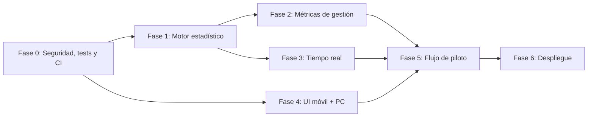

# Roadmap — Plataforma de Evaluación Ciega

Objetivo: dejar la plataforma lista para **pilotos reales con jueces externos**, con **métricas de gestión**, **análisis de acuerdo inter-jueces en tiempo real** (Krippendorff α y otros) y **UI usable en móvil y PC**.

---

## Fase 0 — Base sólida (bloqueante antes de jueces externos)

| # | Tarea | Motivo |
|---|---|---|
| 0.1 | Reemplazar auth por header `X-User-Id` por **token firmado** (cookie `HttpOnly` o JWT con expiración). | Hoy cualquiera puede enviar `X-User-Id: 1` y actuar como admin sin contraseña (verificado). |
| 0.2 | **Hash de contraseñas** (argon2/bcrypt) con migración transparente al primer login. | Hoy se guardan en texto plano. |
| 0.3 | Restringir jueces a **campañas asignadas** (`campaign_judges`, hoy vacía) y validar `campaign_id`/`session_id` contra el usuario. | Aislamiento entre pilotos. |
| 0.4 | Corregir bug: en `get_admin_metrics` el κ de calibración se **sobrescribe** con el κ global. | Métrica reportada incorrecta. |
| 0.5 | Validar puntajes dentro de `[min_score, max_score]` y que la respuesta pertenezca a la pregunta en `/api/evaluation/submit`. | Integridad de datos. |
| 0.6 | Tests con `pytest` + `TestClient` sobre DB temporal; **GitHub Actions** (lint + tests). | Red de seguridad para lo que sigue. |
| 0.7 | Dividir `app.py` (1.500 líneas) en routers: `auth`, `evaluation`, `admin`, `metrics`, `export`. | Mantenibilidad. |

**Criterio de cierre:** sin acceso a `/api/admin/*` sin token válido; tests verdes en CI.

---

## Fase 1 — Motor estadístico de acuerdo (`backend/stats/`)

Funciones puras (numpy/scipy), independientes de la API y con tests contra implementaciones de referencia (`krippendorff`, `pingouin`, `statsmodels`).

| Métrica | Nivel de medida | Uso |
|---|---|---|
| **Krippendorff α** | nominal, **ordinal**, **intervalo** | Métrica principal: tolera datos faltantes y N jueces variable. |
| Fleiss κ | nominal | Compatibilidad con lo existente. |
| **Cohen κ ponderado** (cuadrático) | ordinal | Matriz **juez × juez** para detectar pares divergentes. |
| **ICC(2,1) / ICC(2,k)** | intervalo | Consistencia absoluta de puntajes. |
| Gwet AC2 | ordinal | Robusto a la "paradoja del kappa" (distribuciones sesgadas). |
| % acuerdo exacto y **±1** | — | Lectura intuitiva para gestión. |

- Desgloses: global, **por criterio**, **por variante**, **calibración vs producción**.
- **IC 95 % por bootstrap** (por ítem) y semáforo interpretativo (α ≥ 0.80 fiable; 0.667–0.80 tentativo; < 0.667 insuficiente).
- Comparación de variantes: **Friedman** + post-hoc **Wilcoxon** con corrección de Holm; tamaño de efecto. Export largo para modelos mixtos externos (R/Python).
- Nuevas dependencias: `numpy`, `scipy` (runtime); `krippendorff`, `pingouin` (solo tests).

---

## Fase 2 — Métricas de gestión del piloto

- **Progreso:** % por campaña, por juez y por ítem; cobertura (nº de jueces por ítem vs objetivo); ritmo (ítems/hora) y **ETA** vs `deadline`.
- **Calidad del juez:** severidad/lenidad (media del juez vs grupo, z-score), **straight-lining** (varianza ≈ 0), **speeders** (latencia bajo umbral), acuerdo de cada juez con el consenso.
- **Auditoría de desacuerdos:** top-N ítems/respuestas con mayor dispersión, con acceso directo al texto para discusión de calibración.
- **Actividad:** jueces conectados ahora (heartbeat), tiempo efectivo por sesión, abandonos.
- **Resultados:** medias, medianas, DE e IC por variante × criterio; distribución de puntajes.

---

## Fase 3 — Tiempo real

- Endpoint **SSE** `GET /api/admin/stream?campaign_id=…` que emite métricas actualizadas tras cada `submit` (bus de eventos en proceso).
- Recalculo **incremental/cacheado** por campaña (invalidación en cada envío) para no recalcular todo en cada petición.
- Fallback a *polling* configurable si SSE no está disponible (proxies).

---

## Fase 4 — UI móvil + PC

- CSS **mobile-first** con breakpoints `360 / 768 / 1280 px`; hoy `styles.css` no tiene `@media` y `minmax(350px, 1fr)` desborda en móviles.
- **Evaluación (juez):**
  - Móvil: una respuesta por vista con pestañas/swipe A·B·C, rúbrica debajo, botones de puntaje ≥ 44 px, barra de envío fija, progreso visible.
  - PC: respuestas lado a lado con rúbrica fija.
  - **Autoguardado** de borrador (localStorage) y reintento ante cortes de red.
- **Admin:** dashboard de KPIs en tarjetas, heatmap juez × juez, gráficos de α por criterio; tablas que pasan a tarjetas en móvil.
- Opcional: PWA instalable; servir Chart.js/íconos localmente (sin CDN).
- Verificación manual en 360 px y ≥ 1280 px en cada cambio.

---

## Fase 5 — Flujo de piloto de punta a punta

- **Asistente de campaña:** crear → rúbrica → jueces → dataset → revisar → activar → cerrar.
- **Vista previa y validación del CSV** antes de importar (columnas, duplicados, celdas vacías).
- **Diseño de asignación:** todos evalúan todo, o subconjuntos balanceados con **solapamiento configurable** para medir acuerdo; ítems de calibración obligatorios al inicio.
- Instrucciones/consentimiento para jueces; duplicar campaña; congelar resultados al cerrar.
- **Reporte del piloto** exportable (HTML/PDF) con métricas, acuerdo y comentarios.

---

## Fase 6 — Despliegue

- `Dockerfile` + `docker-compose.yml` (volumen para `data/`).
- Respaldos automáticos de SQLite (`.backup` programado).
- HTTPS vía proxy inverso (p. ej. Caddy) y guía de despliegue en VPS.

---

## Decisiones abiertas

1. **Alcance del repositorio:** solo esta plataforma (actual) o la suite completa.
2. **Visibilidad y licencia** del repo (privado/público; MIT, Apache-2.0, etc.).
3. **Dónde correrá el piloto:** red local vs Internet (define la urgencia de la Fase 0).
4. **Escala de medida** de la rúbrica a reportar como principal (¿ordinal o intervalo para α?).
