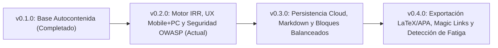

# Roadmap — Plataforma de Evaluación Ciega (`judge-platform`)

Este documento describe la evolución del proyecto desde la extracción inicial (`v0.1.0`), la versión actual de pilotos estadísticos en tiempo real (`v0.2.0`) y las próximas iteraciones planificadas (`v0.3.0` y `v0.4.0`).

---

## Estado Actual: `v0.2.0` (Completado)

| Bloque | Estado | Implementación |
|---|---|---|
| **Fase 0 — Seguridad OWASP y Tests** | ✅ Completado (`v0.2.0`) | Tokens firmados `HMAC-SHA256`, contraseñas `PBKDF2-HMAC-SHA256` con auto-migración, rate-limiting en `/api/auth/login` (`HTTP 429`), prevención de IDOR en sesiones/evaluaciones, sanitización *CSV Formula Injection*, cabeceras HTTP de seguridad y suite `tests/test_stats_and_api.py`. |
| **Fase 1 — Motor Estadístico (`backend/stats.py`)** | ✅ Completado (`v0.2.0`) | **Krippendorff's $\alpha$** (nominal, ordinal, intervalo + IC 95 % bootstrap), **AC2 de Gwet**, **ICC(2,1) / ICC(2,k)**, **Kappa de Fleiss**, matriz par-a-par **Cohen's $\kappa_w$**, acuerdo exacto y $\pm 1$, **Test de Friedman** y post-hoc **Wilcoxon + Holm-Bonferroni**. |
| **Fase 2 — Gestión Operativa del Piloto** | ✅ Completado (`v0.2.0`) | Progreso global y por juez, jueces online en vivo, ritmo (`casos/hora`), **ETA**, sesgo de severidad/lenidad ($z$-score), banderas de calidad (*speeder*, *straight-lining*, *bajo acuerdo*) y **Consola de Auditoría de Desacuerdos**. |
| **Fase 3 — Tiempo Real (SSE)** | ✅ Completado (`v0.2.0`) | Stream `GET /api/admin/stream` con reconexión automática e indicador en vivo en `admin.html`. |
| **Fase 4 — UX Anti-Sesgo y Mobile + PC** | ✅ Completado (`v0.2.0`) | Eliminación de indicadores que inducían efecto Hawthorne / auto-calibración en `evaluate.html`, navegación al **Caso Anterior** con precarga de puntajes, modo enfocado por pestañas A·B·C en móvil ($\ge 46\text{ px}$), autoguardado en `localStorage` y sub-navegación segmentada en 4 vistas analíticas en `admin.html`. |

---

## Próximas Versiones Planificadas (`v0.3.0` – `v0.4.0`)

### `v0.3.0` — Persistencia Cloud, Formato Rico y Diseños Experimentales Escalables
1. **Adaptador Dual SQLite / PostgreSQL (`DATABASE_URL`)**:
   - Permitir conectar a PostgreSQL gestionado (Neon, Supabase, Render Postgres) o Turso/libSQL en entornos *cloud* sin disco local persistente, manteniendo SQLite como opción por defecto en local.
2. **Renderizado Seguro de Markdown y Citas en Respuestas**:
   - Formatear listas, negritas, tablas y bloques de código dentro de las respuestas evaluadas (con sanitización `DOMPurify`) para mejorar la legibilidad de textos largos sin comprometer el anonimato de la fuente.
3. **Asignación por Bloques Incompletos Balanceados (*Balanced Incomplete Block Design — BIBD*)**:
   - Soportar bancos grandes ($>50$ casos) donde cada juez evalúa un subconjunto de $M$ preguntas más las preguntas obligatorias de calibración (`is_calibration=1`), maximizando la cobertura total sin agotar a cada evaluador.
4. **Ranking Preferencial / Desempate Explícito (*Best-Worst / Bradley-Terry*)**:
   - Opción por campaña para que el juez, tras puntuar la rúbrica, elija opcionalmente la mejor respuesta global del caso ($A \succ B \succ C$), calculando un ranking **Elo / Bradley-Terry** complementario a los puntajes Likert.
5. **Previsualizador y Validador Interactivo de CSV (*Dry-Run*)**:
   - Vista previa antes de confirmar la importación de un CSV que valide columnas, codificación, preguntas repetidas y respuestas vacías.
6. **Modularización de Routers FastAPI**:
   - Separar `backend/app.py` en submódulos (`routers/auth.py`, `routers/evaluation.py`, `routers/admin.py`, `routers/analytics.py`) a medida que crezcan los endpoints en `v0.3.0`.

---

### `v0.4.0` — Publicación Científica Directa y Automatización de Paneles
1. **Exportador de Tablas LaTeX (`booktabs`) y Reportes APA / PDF**:
   - Descarga directa del código LaTeX y tablas Markdown con las métricas de acuerdo ($\alpha$ ordinal/intervalo + IC 95 %, AC2, ICC) y resultados inferenciales ($\chi^2$ de Friedman y $p_{\text{Holm}}$ de Wilcoxon) listos para incluir en artículos o capítulos de tesis.
2. **Acceso por Enlace Mágico (*Magic Links*) y Pantalla de Consentimiento Informado**:
   - Generación de enlaces únicos firmados por juez (acceso directo en 1 clic desde WhatsApp/correo en móvil) y aceptación opcional de protocolo ético / instrucciones antes del Caso #1.
3. **Detección en Vivo de Fatiga Intrasesión**:
   - Monitoreo de la curva de tiempo de respuesta y caída de varianza dentro de una misma sesión, sugiriendo pausas activas al juez tras $N$ casos consecutivos.
4. **Sellado Criptográfico de Campañas Cerradas (*Reproducible Audit Trail*)**:
   - Opción para congelar definitivamente una campaña finalizada y emitir un manifiesto firmado (`SHA-256`) del dataset, rúbrica y matriz de evaluaciones.
5. **Modo Claro / Oscuro para Lectura Extendida**:
   - Tema claro de alto contraste (estilo papel académico) conmutable desde la barra superior del evaluador.
